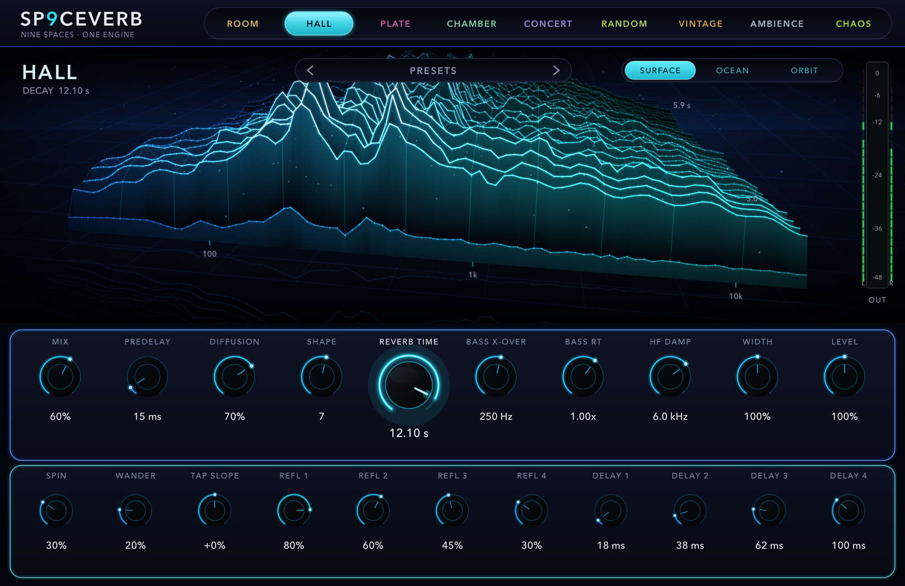
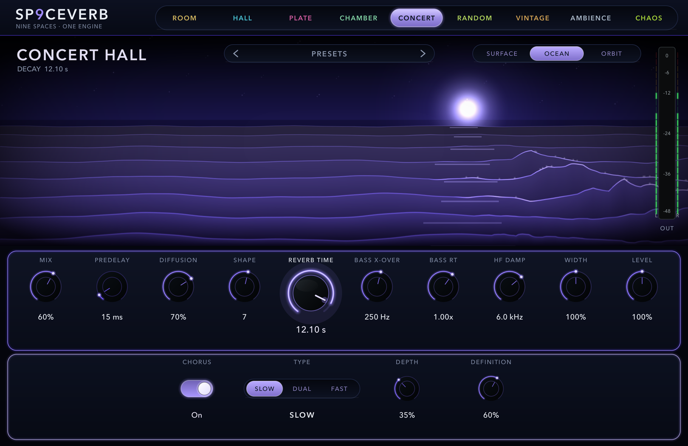
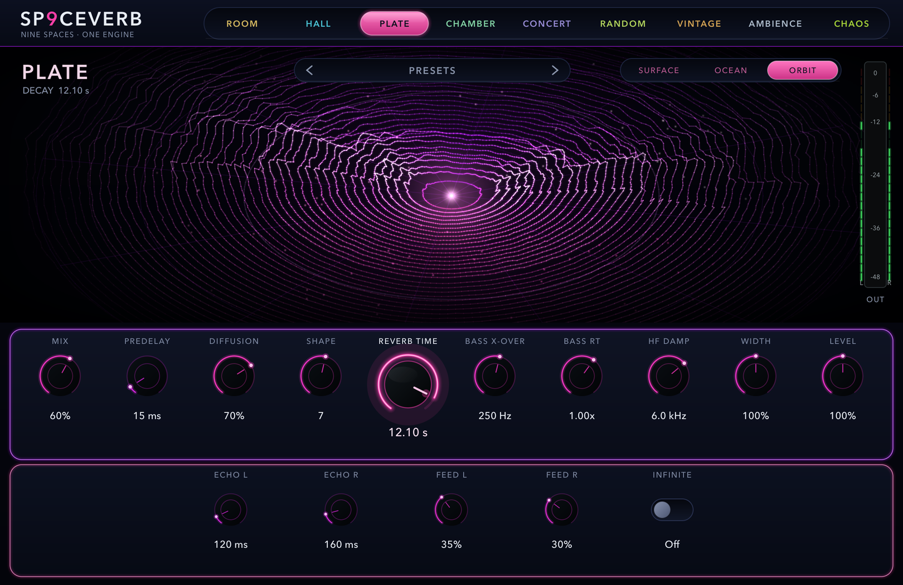
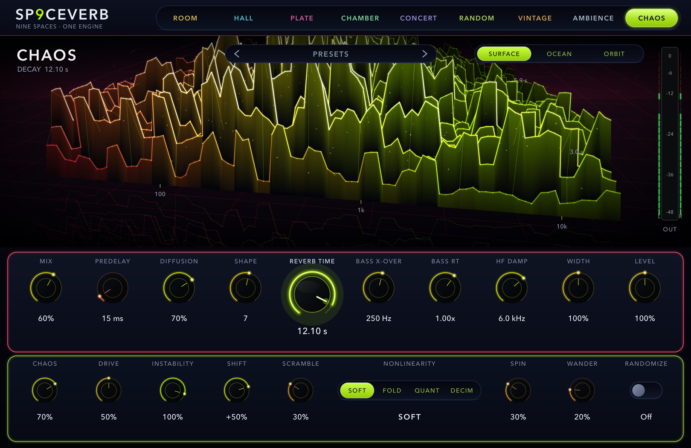
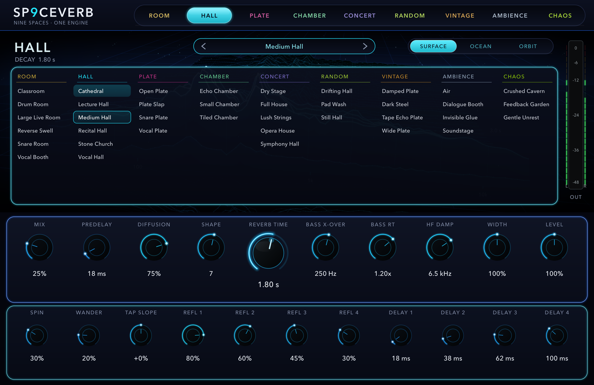

# Sp9ceVerb

**A reverb plugin with nine spaces on one engine, by OpenGrid.** Room, Hall,
Plate, Chamber, Concert Hall, Random Hall, Vintage Plate, Ambience and Chaos
share one signal path, and the editor shows the reverb as it works.



| Ocean view (Concert Hall) | Orbit view (Plate) |
|---|---|
|  |  |

| Chaos | Preset browser |
|---|---|
|  |  |

*The pictures are rendered from the plugin's own editor code by `sp9ceverb-preview`.*

## Version 1.0.1-Beta

A fix release of the beta. The reported tail now covers the reversed Room
pattern, so exports keep its whole ring-out, and that pattern sounds the same
at every sample rate. Sessions from 1.0-Beta open as before.

- Nine spaces, each with its own controls below ten shared ones.
- Three displays of the same signal: a 3D decay surface, an ocean of waves and
  an orbit view, with a stereo output meter.
- 38 factory presets, chosen from the preset bar or the browser.
- CLAP, VST3, Audio Unit, LV2 and AAX, each a universal binary for Apple
  silicon and Intel Macs.
- The tail length is reported to the host, so exports keep the ring-out
  (CLAP, VST3 and Audio Unit).
- Chaos: in-loop nonlinearity, governed self-oscillation, pitch drift and
  scramble. Its output stays at or below -0.5 dBFS and is repeatable.

## Download

**macOS 11 or later, Apple silicon and Intel:**
[Sp9ceVerb-1.0.1-Beta-macos.pkg](https://github.com/MistaMin/Sp9ceVerb/releases/download/v1.0.1-Beta/Sp9ceVerb-1.0.1-Beta-macos.pkg) ·
[Sp9ceVerb-1.0.1-Beta-macos.dmg](https://github.com/MistaMin/Sp9ceVerb/releases/download/v1.0.1-Beta/Sp9ceVerb-1.0.1-Beta-macos.dmg) ·
[User manual (PDF)](https://github.com/MistaMin/Sp9ceVerb/releases/download/v1.0.1-Beta/Sp9ceVerb-User-Manual.pdf)

The installer offers **CLAP, VST3, Audio Unit, LV2 and AAX**, one choice per
format.
It is signed with Developer ID and notarized by Apple, and the AAX is signed
with PACE Eden for Pro Tools. The disk image holds the same installer with the
manual and the licence texts. Checksums are on the
[release page](https://github.com/MistaMin/Sp9ceVerb/releases/tag/v1.0.1-Beta).

This is a beta. There is no Windows or Linux build yet and no standalone
application in this release. The AAX passes Avid's validator and was tested
in Pro Tools 2025.10; see the release notes for what is still open there.

## User guide

See the [user manual](docs/USER_MANUAL.md): every control with its range and
default, the displays, the presets and the host notes. Changes are in the
[changelog](CHANGELOG.md) and the [release notes](RELEASE_NOTES.md).

## The spaces

| Space | Character |
|---|---|
| Room | early-reflection patterns, optional reverse, separate early and tail predelay |
| Hall | four adjustable early reflections, slow modulation, tap slope |
| Plate, Chamber | a plate-style tail with left and right echoes and an Infinite hold |
| Concert Hall | a hall with a selectable chorus and a Definition control |
| Random Hall | a hall with stronger modulation |
| Vintage Plate | a plate with one discrete reflection per side, echoes and Infinite |
| Ambience | short, dense and unobtrusive: a front softener, a small room and a quiet plateau |
| Chaos | deliberately unstable, and still bounded |

The design is original. Where it came from is stated in
[docs/PROVENANCE.md](docs/PROVENANCE.md), and where the preset values came from
in [presets/README.md](presets/README.md).

## Build from source

```sh
cargo test --workspace --release      # engine tests, no SDK needed
scripts/build.sh                      # CLAP and LV2 into dist/
scripts/build.sh --install            # also copy them to ~/Library/Audio/Plug-Ins
scripts/build_shells.sh               # VST3, Audio Unit and AAX into dist/
```

Rust is required. OpenPluginSDK (0.2.0-beta) and GoodLookinDri (0.1.0) are found at build time (a
`Dependencies` folder next to or above this one, or the `OPENPLUGIN_SDK` and
`GOODLOOKINDRI` variables). `scripts/build_shells.sh` also needs the VST3 SDK,
the AudioUnitSDK and, for AAX, the Avid AAX SDK. Pro Tools only loads an AAX
that is signed (`scripts/sign_aax.sh`). The builds are universal and need the
Rust targets `aarch64-apple-darwin` and `x86_64-apple-darwin`;
`SP9CE_ARCHS=arm64` builds one architecture.

How the repository is laid out:

- `crates/engine` (`sp9ce-engine`): the DSP. No dependencies and no allocation
  on the audio path. One signal path, nine voicings.
- `plugin` (`sp9ceverb`): the plugin on OpenPluginSDK, the GoodLookinDri
  editor, the CLAP entry, the LV2 and the C interface the VST3, Audio Unit
  and AAX shells link.
- `presets/`: the factory presets as text files, one folder per space. They
  are built into the plugin.
- `tools/`: the measurement runner, the level calibration, the editor checks
  and `build_user_manual.py`, which builds the PDF manual.

## License

Sp9ceVerb source code is [MIT licensed](LICENSE); copyright (c) 2026 Marcos
Quirino Deida. The official binaries are distributed as **freeware**, free of
charge for personal or commercial audio production. See the
[official binary terms](BINARY_LICENSE.txt) and the
[third-party licences](THIRD_PARTY_LICENSES.md).

The AAX links the Avid AAX SDK, which is not covered by the MIT licence and is
not in this repository. VST is a trademark of Steinberg Media Technologies
GmbH. Audio Units is a trademark of Apple Inc. AAX and Pro Tools are
trademarks of Avid Technology, Inc.
