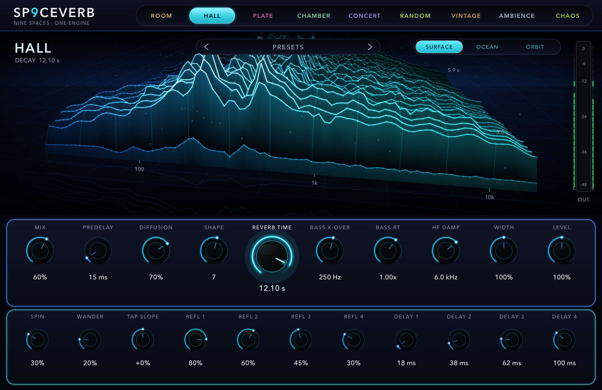
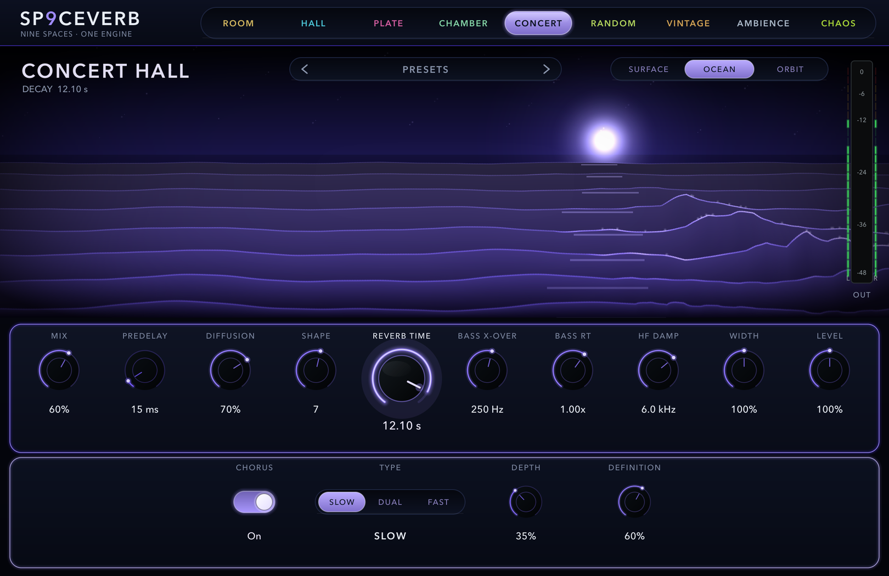
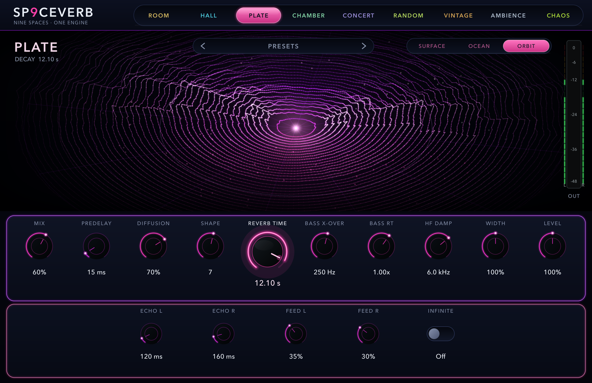
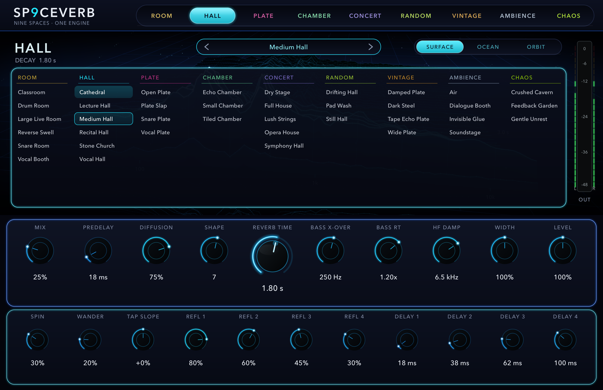

# Sp9ceVerb 1.0.1-Beta User Manual

## 1. What it is

Sp9ceVerb is a stereo reverb plugin with nine spaces ("voicings") on one
engine. You pick a space with the keys in the header; the controls below the
display change to match it. The editor shows the reverb working, in three
views of the same signal (section 6), and has a preset bar with a browser
(section 7).

The nine spaces:

| Space | Character |
|---|---|
| Room | early-reflection patterns (eight of them), optional reverse, separate early and tail predelay |
| Hall | four adjustable early reflections, slow modulation (Spin, Wander), tap slope |
| Plate | a plate-style tail with left and right echoes and an Infinite hold |
| Chamber | the same controls as Plate with its own character |
| Concert Hall | a hall with a selectable chorus (Slow, Dual, Fast) and a Definition control |
| Random Hall | a hall with stronger modulation and a Randomize switch |
| Vintage Plate | a plate with two discrete reflections (one per side), each with its own delay, gain, tap mode and polarity, plus echoes and Infinite |
| Ambience | short, dense and unobtrusive: a front softener, a small room and a quiet plateau |
| Chaos | a deliberately unstable reverb: in-loop nonlinearity, governed self-oscillation, pitch drift and scramble |

Where the design came from is stated in `docs/PROVENANCE.md`.

## 2. System requirements

- A Mac with Apple silicon or an Intel processor. Every format is a universal
  binary (arm64 and x86_64).
- macOS 11.0 or later.
- A host that loads CLAP, VST3, Audio Unit (effect), LV2 or AAX plugins.
- The editor uses Cocoa and Core Text, so it is macOS only.
- Windows and Linux are not supported in this release, and there is no
  standalone application.

## 3. Installing

Run `Sp9ceVerb-1.0.1-Beta-macos.pkg`. The installer offers one choice per format
and installs to the system-wide folders:

| Format | Installed to |
|---|---|
| CLAP | `/Library/Audio/Plug-Ins/CLAP/Sp9ceVerb.clap` |
| VST3 | `/Library/Audio/Plug-Ins/VST3/Sp9ceVerb.vst3` |
| Audio Unit | `/Library/Audio/Plug-Ins/Components/Sp9ceVerb.component` |
| LV2 | `/Library/Audio/Plug-Ins/LV2/Sp9ceVerb.lv2` |
| AAX (Pro Tools) | `/Library/Application Support/Avid/Audio/Plug-Ins/Sp9ceVerb.aaxplugin` |

Rescan plugins in your host afterwards. The Audio Unit appears as
"OpenGrid: Sp9ceVerb" (type `aufx`, subtype `Sp9v`, manufacturer `OpGd`); the
CLAP id is `com.opengrid.sp9ceverb`, and the LV2 is
`https://opengrid.studio/plugins/sp9ceverb`. Hosts show the version as
`1.0.1-beta`.

To uninstall, delete the bundles from the folders above.

## 4. Controls

Every value below comes from the parameter table in
`crates/engine/src/params.rs`. The host sees the parameters under the names in
the "Host name" column. The editor prints a shorter label in capitals, shown in
brackets where it differs. Time values are in seconds and frequencies in hertz
in the host; the editor prints times under one second in ms and frequencies
from 1000 Hz in kHz.

A voicing control only acts in its own space. In other spaces the host still
lists it, but changing it does nothing.

Some controls belong to more than one space and keep one value across them:
Spin and Wander (Hall, Random Hall, Chaos), Randomize (Room, Random Hall,
Chaos), and the echoes and Infinite (Plate, Chamber, Vintage Plate). A new
instance, and a double-click on the knob, uses the default of the first space
in that list. The other defaults in the tables below are what a preset of that
space starts from when it does not name the control.

### 4.1 Mode

| Host name | Range | Default |
|---|---|---|
| Mode | 9 steps: Room, Hall, Plate, Chamber, Concert Hall, Random Hall, Vintage Plate, Ambience, Chaos | Hall |

### 4.2 Common controls (every space)

| Host name (editor label) | Range | Default | Notes |
|---|---|---|---|
| Mix | 0 to 1 (0 to 100%) | 0.25 (25%) | Linear dry/wet crossfade. |
| Predelay | 0 to 0.2 s | 0.015 s (15 ms) | |
| Diffusion | 0 to 1 | 0.7 (70%) | |
| Shape | 12 steps, shown 1 to 12 | step 7 (index 6) | Builds up the onset of the tail. |
| Reverb Time | 0.1 to 20 s | 1.6 s | The 60 dB decay time. |
| Bass X-Over (BASS X-OVER) | 20 to 2000 Hz | 250 Hz | Where Bass RT takes over. |
| Bass RT | 0.1 to 4x | 1.0x | Multiplier on the decay of the low band. |
| HF Damping (HF DAMP) | 500 to 20000 Hz | 6000 Hz | Acts inside the decay loop. |
| Width | 0 to 2 (0 to 200%) | 1.0 (100%) | Side gain is proportional to Width. |
| Level | 0 to 2 (0 to 200%) | 1.0 (100%) | Linear output level. |

### 4.3 Room

| Host name (editor label) | Range | Default |
|---|---|---|
| Pattern | 8 steps, shown 1 to 8 | 4 (index 3) |
| Reverse | off / on | off |
| Randomize | off / on | off |
| Room Scale (SCALE) | 0.25 to 4x | 1.0x |
| Early Predelay (EARLY PRE) | 0 to 0.2 s | 0 s |
| Tail Predelay (TAIL PRE) | 0 to 0.2 s | 0.015 s |

### 4.4 Hall

| Host name (editor label) | Range | Default |
|---|---|---|
| Spin | 0 to 1 | 0.3 |
| Wander | 0 to 1 | 0.2 |
| Tap Slope (TAP SLOPE) | -1 to 1 (-100% to +100%) | 0 |
| Refl 1 Level (REFL 1) | 0 to 1 | 0.8 |
| Refl 2 Level (REFL 2) | 0 to 1 | 0.6 |
| Refl 3 Level (REFL 3) | 0 to 1 | 0.45 |
| Refl 4 Level (REFL 4) | 0 to 1 | 0.3 |
| Refl 1 Delay (DELAY 1) | 0 to 0.3 s | 0.018 s |
| Refl 2 Delay (DELAY 2) | 0 to 0.3 s | 0.038 s |
| Refl 3 Delay (DELAY 3) | 0 to 0.3 s | 0.062 s |
| Refl 4 Delay (DELAY 4) | 0 to 0.3 s | 0.100 s |

### 4.5 Plate and Chamber

Both spaces expose the same controls and the same defaults.

| Host name (editor label) | Range | Default |
|---|---|---|
| Echo Time L (ECHO L) | 0 to 1.2 s | 0.12 s |
| Echo Time R (ECHO R) | 0 to 1.2 s | 0.16 s |
| Echo Feedback L (FEED L) | 0 to 0.95 | 0.35 |
| Echo Feedback R (FEED R) | 0 to 0.95 | 0.30 |
| Infinite | off / on | off |

### 4.6 Concert Hall

| Host name (editor label) | Range | Default |
|---|---|---|
| Chorus | off / on | on |
| Chorus Type (TYPE) | Slow, Dual, Fast | Slow |
| Chorus Depth (DEPTH) | 0 to 1 | 0.35 |
| Definition | 0 to 1 | 0.6 |

### 4.7 Random Hall

| Host name (editor label) | Range | Default |
|---|---|---|
| Spin | 0 to 1 | 0.6 |
| Wander | 0 to 1 | 0.5 |
| Randomize | off / on | off |

### 4.8 Vintage Plate

| Host name (editor label) | Range | Default |
|---|---|---|
| Refl L Delay (REFL L) | 0 to 0.12 s | 0.012 s |
| Refl L Gain (GAIN L) | 0 to 1 | 0.9 |
| Refl L Mode (TAPS L) | 1, 2, 3 | 2 |
| Refl L Polarity (INVERT L) | off / on | off |
| Refl R Delay (REFL R) | 0 to 0.12 s | 0.017 s |
| Refl R Gain (GAIN R) | 0 to 1 | 0.9 |
| Refl R Mode (TAPS R) | 1, 2, 3 | 2 |
| Refl R Polarity (INVERT R) | off / on | off |
| Echo Time L (ECHO L) | 0 to 1.2 s | 0.10 s |
| Echo Time R (ECHO R) | 0 to 1.2 s | 0.13 s |
| Echo Feedback L (FEED L) | 0 to 0.95 | 0.40 |
| Echo Feedback R (FEED R) | 0 to 0.95 | 0.35 |
| Infinite | off / on | off |

### 4.9 Ambience

| Host name (editor label) | Range | Default | Notes |
|---|---|---|---|
| Size | 0.5 to 5x | 1.0x | Scales the geometry (delay lengths only). At 5x the lines are as long as a large hall's. |
| Tone | 0 to 1 | 0.5 | Dark to bright: high-frequency decay and level. |
| Character | 0 to 1 | 0.5 | Front-heavy to room-heavy: where the fast decay hands over to the plateau. |

### 4.10 Chaos

| Host name (editor label) | Range | Default | Notes |
|---|---|---|---|
| Chaos | 0 to 1 | 0 | Macro. At 0 the reverb is untouched; at 1 it is fully unstable. |
| Drive | 0 to 1 | 0.5 | How hard the in-loop nonlinearity is driven. |
| Instability | 0 to 1.15 | 1.0 | Loop gain above unity: how strongly the network sustains itself. |
| Shift | -1 to 1 (-100% to +100%) | 0.5 (+50%) | Direction and amount of pitch drift in the loop. At full Chaos and Shift = 1 the drift is 12 cents. |
| Scramble | 0 to 1 | 0.3 | How often the delay network re-seats itself (deterministically). |
| Nonlinearity | Soft, Fold, Quant, Decim | Soft | Type of the in-loop nonlinearity. |
| Spin | 0 to 1 | 0.6 | |
| Wander | 0 to 1 | 0.5 | |
| Randomize | off / on | off | |

### 4.11 Using the knobs

- Drag a knob vertically to change it.
- Double-click a knob to return it to its default.
- Scroll over a knob to step it (2% of the range, or one step on stepped controls).
- Click a switch to toggle it. Click a segment of a key bank (Chorus Type, Refl Mode,
  Nonlinearity) to select it.
- Drags and clicks are reported to the host as automation gestures, so they
  can be recorded.

## 5. The tail, Infinite and Chaos

- The plugin tells the host how long the output rings after the input stops
  (CLAP, VST3 and Audio Unit). That length is the Reverb Time (lengthened by
  Bass RT above 1x), plus the time the Plate, Chamber and Vintage Plate echoes
  take to fall 60 dB, plus a small margin of 1.5 s. Hosts use it to keep
  rendering the tail during export.
- Infinite (Plate, Chamber, Vintage Plate) holds the tail without decay. The
  plugin then reports an infinite tail, and the display shows "DECAY HELD".
- Chaos above 0 in the Chaos space sustains itself, so the tail is reported as
  infinite there too. At Chaos = 0 the chaos path is skipped entirely and the
  space behaves as a normal reverb.
- Chaos output stays at or below -0.5 dBFS, and it is deterministic: the same
  input and settings give the same output.
- AAX and LV2 do not report a tail length to the host in this release. There,
  let the track play on or extend the clip after the last note so the tail is
  not cut off when bouncing.
- With long Reverb Time, high Echo Feedback or Infinite on, an insert may keep
  ringing after you stop playback. Turn Infinite off or lower Chaos to let it
  decay.

## 6. The display

The large area under the header has three views, chosen with the SURFACE /
OCEAN / ORBIT switch at the top right of the display. The header line shows the
current space and the decay time ("DECAY 1.60 s", or "DECAY HELD").

- SURFACE: a 3D decay surface. Frequency runs across the front edge (marks at
  100, 1k and 10k Hz), time runs into the distance (marks in seconds), and
  level is height. The surface is computed from the controls (decay per
  frequency, predelay, build-up, diffusion), and the live output spectrum
  rides on it as a waterfall.
- OCEAN: waves driven by the output. Eight layers, one per frequency band,
  with the highs on the horizon and the lows in front. Time runs right to left.
- ORBIT: the source sits in the middle and the response spreads outward. Each
  ring is a moment in time, frequency runs around the ring, and level pushes
  the ring outward.

| Ocean (Concert Hall) | Orbit (Plate) |
|---|---|
|  |  |

A stereo output meter ("OUT") with peak hold sits at the right edge of the
display in all three views.

## 7. Presets

The preset bar is above the display. Its arrows step to the previous or next
preset; clicking the name opens the preset browser, a panel with one column per
space. Click an entry to load it; click anywhere else to close the browser. A
`*` after the name means you have changed a value since loading it. From no
preset, the arrows start at the first preset of the current space.

Loading a preset sets the parameters it names. A parameter the preset leaves
out keeps the default of its space. Mix values in the presets assume the
plugin is used as an insert; on a send, set Mix to 1.

Factory presets by space (38 in total):

| Space | Presets |
|---|---|
| Room | Classroom, Drum Room, Large Live Room, Reverse Swell, Snare Room, Vocal Booth |
| Hall | Cathedral, Lecture Hall, Medium Hall, Recital Hall, Stone Church, Vocal Hall |
| Plate | Open Plate, Plate Slap, Snare Plate, Vocal Plate |
| Chamber | Echo Chamber, Small Chamber, Tiled Chamber |
| Concert Hall | Dry Stage, Full House, Lush Strings, Opera House, Symphony Hall |
| Random Hall | Drifting Hall, Pad Wash, Still Hall |
| Vintage Plate | Damped Plate, Dark Steel, Tape Echo Plate, Wide Plate |
| Ambience | Air, Dialogue Booth, Invisible Glue, Soundstage |
| Chaos | Crushed Cavern, Feedback Garden, Gentle Unrest |

The presets are built into the plugin. They were written for this project from
general room acoustics and common mixing practice (`presets/README.md`).

## 8. Formats and host notes

| Format | Notes |
|---|---|
| CLAP | With the editor. Passes clap-validator. |
| VST3 | With the editor. |
| Audio Unit | Effect (`aufx`) with the editor. Passes `auval`. |
| LV2 | With the editor, in hosts that show Cocoa editors; other hosts show their own controls for the 54 parameters. The host saves the parameters as control ports. |
| AAX | With the editor, Developer ID signed and PACE signed. Passes Avid's AAX Validator. Not yet tested inside Pro Tools. |

The plugin processes a stereo input to a stereo output. Session state (all
parameters) is saved and restored by the host.

## 9. License

- Source code: MIT License, copyright (c) 2026 Marcos Quirino Deida (`LICENSE`).
- Official binaries: proprietary freeware (`BINARY_LICENSE.txt`). You may
  download, install and use them free of charge, personal or commercial.
- Third-party components and their terms are listed in
  `THIRD_PARTY_LICENSES.md`.
- Third-party notices that ship inside the bundles (in each bundle's
  `Contents/Resources`): the VST3 SDK (`VST3-SDK-LICENSE.txt`), the
  AudioUnitSDK (`AudioUnitSDK-LICENSE.txt`) and the AAX SDK
  (`AAX-SDK-LICENSE.txt`). The installer and disk image carry copies in
  `Licenses/`.
- VST is a trademark of Steinberg Media Technologies GmbH. Audio Units is a
  trademark of Apple Inc. AAX and Pro Tools are trademarks of Avid Technology, Inc.
- Sp9ceVerb is an independent OpenGrid project and claims no affiliation with
  any other reverb or plugin maker.
